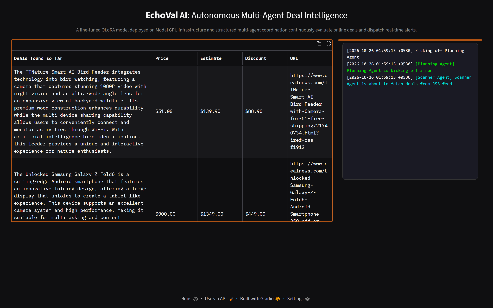
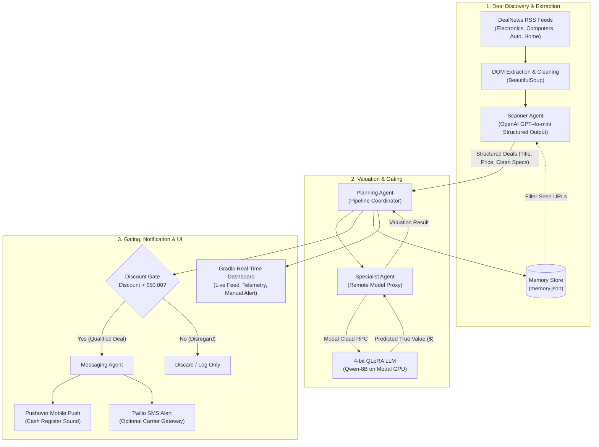
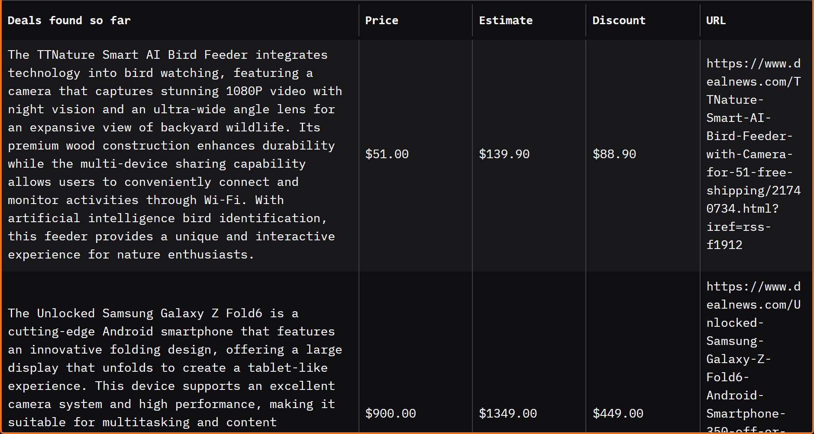
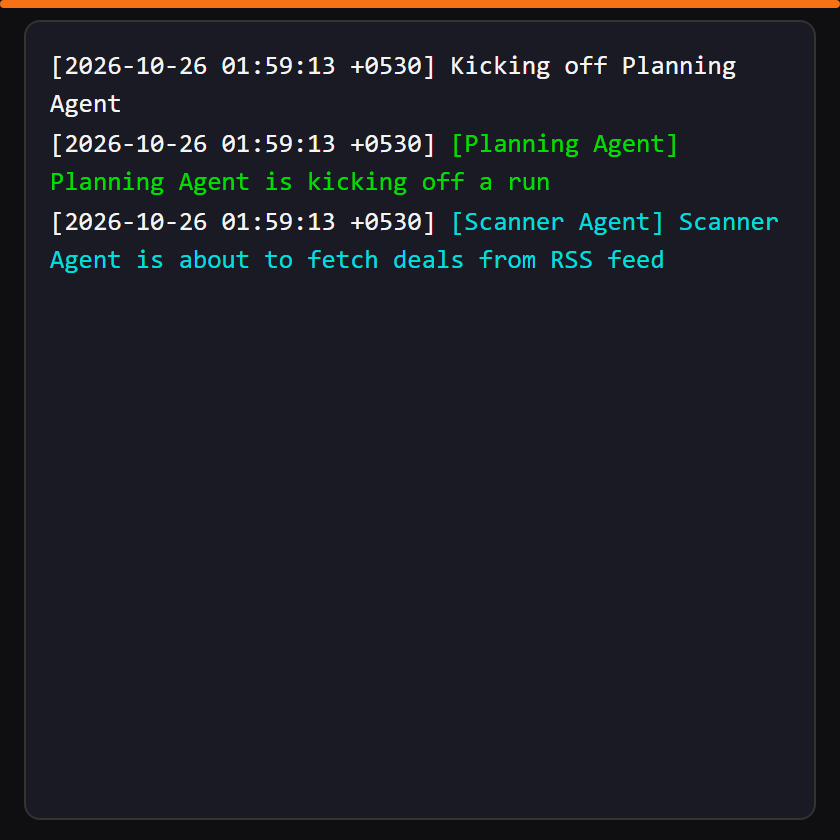
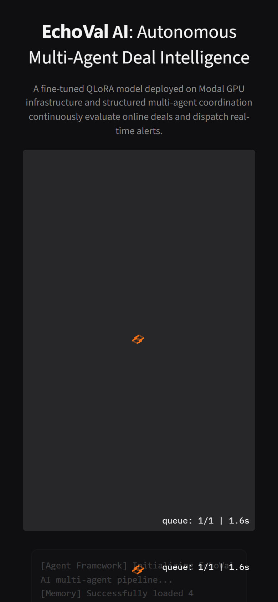

# EchoVal AI: Autonomous Multi-Agent Deal Valuation Platform

[](https://www.python.org/downloads/)
[](#system-architecture)
[](#valuation-engine)
[](#dashboard-interface)
[](LICENSE)

EchoVal AI is an autonomous, multi-agent intelligence platform that continuously scans e-commerce feeds, extracts high-potential deals with structured LLM parsing, predicts authentic market value using a 4-bit QLoRA fine-tuned model deployed on Modal GPU infrastructure, and dispatches real-time mobile push notifications for verified arbitrage opportunities.



---

## The Problem Solved

Online shoppers and deal hunters face extreme operational friction:
- **Information Overload**: Thousands of new deals are published daily across scattered RSS feeds, coupon portals, and marketplace aggregators.
- **Deceptive Discount Pricing**: Advertised "markdowns" and MSRP claims are frequently inflated to create false urgency.
- **Valuation Bottleneck**: Accurately estimating what an item should actually cost requires deep category domain knowledge or tedious manual price comparisons.
- **Latency Risk**: Genuine mispriced deals and high-margin clearance offers sell out within minutes before humans can verify them.

EchoVal AI replaces manual tracking with an automated multi-agent pipeline that ingests, cleans, values, gates, and alerts on profitable opportunities in seconds.

---

## System Architecture



---

## Multi-Agent Specialization

EchoVal AI divides operational responsibilities across four purpose-built agents:

| Agent | Module | Primary Responsibility | Technical Mechanism |
| :--- | :--- | :--- | :--- |
| **Scanner Agent** | `agents/scanner.py` | Ingests feeds and filters candidates | BeautifulSoup parsing + OpenAI Structured Outputs (`DealSelection` Pydantic model) |
| **Specialist Agent** | `agents/specialist.py` | Estimates authentic market valuation | Remote RPC to 4-bit NF4 quantized QLoRA model hosted on Modal cloud GPU |
| **Planning Agent** | `agents/planner.py` | Coordinates end-to-end pipeline execution | Discount threshold computation (`value - price`), memory state updates, triage |
| **Messaging Agent** | `agents/messaging.py` | Dispatches immediate notifications | Pushover HTTPS API with audio cues and Twilio REST SMS integration |

---

## Core Features & Resilience Engineering

- **Structured Output Guarantees**: The Scanner Agent leverages OpenAI Structured Outputs to ensure zero malformed JSON responses, eliminating parsing failures.
- **4-bit QLoRA Quantization**: The valuation model uses NF4 double quantization with BitsAndBytes on Nvidia T4 GPUs, slashing cold-start time while preserving dense pricing accuracy across 400K+ product references.
- **State Persistence & Deduplication**: All evaluated deals are tracked in `memory.json` to prevent duplicate scrapes, redundant LLM token spend, and notification spam.
- **Defensive API Degradation**: The Messaging Agent checks credentials upfront and generates simulated log notifications in development environments when Pushover or Twilio keys are unconfigured.
- **Interactive Gradio Dashboard**: Features real-time log streaming via custom queue handlers, an auto-updating opportunity table, and an interactive row selection handler for on-demand alert re-triggering.

---

## Visual Walkthrough & Dashboard Interface

### 1. Mission Control Dashboard
The Gradio web interface provides centralized controls for multi-agent execution, continuous feed polling, and manual deal dispatch.


*Figure 1: Centralized control dashboard with execution controls and telemetry summary.*

### 2. Qualified Opportunities & Live Agent Telemetry
Displays real-time margin computations and live agent queue streaming.

| Deal Opportunities Table | Real-Time Execution Logs |
| :---: | :---: |
|  |  |
| *Figure 2: Verified arbitrage deals exceeding \$50 margin* | *Figure 3: Multi-agent color-coded execution telemetry* |

### 3. Mobile Viewport Triage
Fully optimized for mobile triage and on-the-go deal verification.


*Figure 4: Mobile-responsive layout for fluid deal verification on handheld devices.*

---

## Technical Decisions & Trade-offs

### 1. Multi-Agent Modular Architecture vs Monolithic Script
- **Decision**: Separated ingestion, valuation, gating, and alerting into discrete agent classes inheriting from a shared logging and telemetry base.
- **Trade-off**: Introduces minor inter-class coordination overhead, but isolates external API failures (such as RSS timeouts or push service downtime) from breaking core valuation workflows.

### 2. Modal Cloud GPU Inference vs Local Model Execution
- **Decision**: Deployed the 8B-parameter fine-tuned QLoRA checkpoint on Modal serverless GPUs (`pricer-service`).
- **Trade-off**: Requires network roundtrips for pricing queries, but eliminates heavy local GPU hardware requirements and enables automated scale-to-zero when no deals are actively being processed.

### 3. Structured Outputs vs Raw Prompt Regex Extraction
- **Decision**: Used Pydantic-backed `response_format=DealSelection` rather than unconstrained text prompts.
- **Trade-off**: Minor latency increase on OpenAI schema parsing, but yields 100% deterministic type safety for product descriptions, prices, and URLs.

---

## Repository Structure

```
EchoVal-AI/
├── .github/
│   └── workflows/
│       └── ci.yml               # GitHub Actions syntax and import validation
├── agents/
│   ├── agent.py                 # Abstract Agent base class with color-coded telemetry
│   ├── deals.py                 # ScrapedDeal, Deal, and Opportunity Pydantic schemas
│   ├── messaging.py             # Pushover push notification and Twilio SMS dispatcher
│   ├── planner.py               # Orchestrator agent coordinating scan, price, and alert
│   ├── scanner.py               # RSS feed scraper with OpenAI Structured Output parser
│   └── specialist.py            # Proxy client for remote Modal QLoRA pricer service
├── docs/
│   └── screenshots/             # Visual UI walkthrough captures
├── deal_agent_framework.py      # Core execution framework and memory management
├── echoval.py                   # Gradio interactive web application and live logger
├── log_utils.py                 # ANSI terminal color formatter and HTML log converter
├── memory.json                  # Persistent state store for evaluated opportunities
├── pricer_service.py            # Modal serverless GPU app definition for QLoRA model
├── requirements.txt             # Locked production dependencies
├── .env.example                 # Sanitized environment configuration template
└── README.md                    # System architecture and engineering documentation
```

---

## Quickstart & Local Setup

### 1. Clone Repository & Create Environment
```bash
git clone https://github.com/SambhavJain26/EchoVal-AI.git
cd EchoVal-AI

# Create and activate virtual environment
python -m venv .venv

# Windows PowerShell
.\.venv\Scripts\Activate.ps1

# Linux / macOS
source .venv/bin/activate
```

### 2. Install Dependencies
```bash
pip install -r requirements.txt
```

### 3. Configure Environment Variables
```bash
cp .env.example .env
```
Edit `.env` and set your credentials:
```ini
OPENAI_API_KEY=sk-proj-...

# Optional: Push notifications
PUSHOVER_USER=your_user_key
PUSHOVER_TOKEN=your_app_token
```

### 4. Launch the Dashboard
```bash
python echoval.py
```
Open your browser to `http://localhost:7860` to access the live EchoVal AI dashboard.
